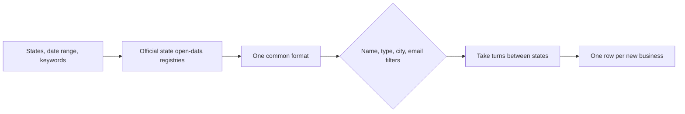

# New Business Registrations: Daily State Filing Leads

[](https://apify.com/Turboextract/new-business-registrations)
[](LICENSE)
[](#pricing)

**Get every new LLC and corporation registered in New York, Connecticut, Colorado, Oregon and Texas, days after it files.** Each lead has the business name, entity type, registration date, address, registered agent, owners or members where the state lists them, and a business email for Connecticut filings. Data comes straight from each state's official open-data registry.

A business that registered last week needs everything at once: a bank account, insurance, an accountant, a website, payroll, a phone system, signage. Reach it before its inbox fills up.

**Try it now →** [apify.com/Turboextract/new-business-registrations](https://apify.com/Turboextract/new-business-registrations)

---

## Why this exists

- A business that registered last week needs a bank, insurance, an accountant and a website all at once.
- Every state publishes its registrations differently, and most never send them anywhere.
- Connecticut publishes a business email on almost every new filing, but few people know it.
- New-business lead lists are usually sold as monthly subscriptions.

---

## Who this is for

- **Accountants, bookkeepers and tax firms** looking for brand-new businesses before their first filing
- **Insurance agents** selling general liability, workers' comp and commercial auto
- **Web designers, marketing agencies and SEO shops** pitching a first website
- **Banks, lenders and payment processors** offering business accounts and merchant services
- **Registered agent, compliance and payroll services**
- **Market researchers** tracking new business formation by city and industry

---

## What you get per business

```json
{
  "company": "Alzion Technologies LLC",
  "state": "CT",
  "entityType": "LLC",
  "registeredDate": "2026-11-15",
  "status": "Active",
  "jurisdiction": "Connecticut",
  "address": { "street": "108 W Avon Rd", "city": "Avon", "state": "CT", "zip": "06001-3513" },
  "addressType": "business",
  "email": "a***@gmail.com",
  "industry": "Custom Computer Programming Services (541511)",
  "ownership": { "womanOwned": false, "veteranOwned": false, "minorityOwned": false },
  "registryId": "3551228",
  "source": "Connecticut Secretary of the State"
}
```

Oregon rows add the members, managers and officers by name. Colorado and New York rows add the registered agent.

---

## What each state publishes

| State | New filings per week | Extras |
|---|---|---|
| New York | about 4,700 | County, service of process name and address, registered agent |
| Connecticut | about 1,000 | **Business email on almost every filing**, NAICS industry, owner diversity flags |
| Colorado | several hundred | Principal office, registered agent, link to the state record |
| Oregon | about 8,000 per month | Members, managers and officers by name (monthly file) |
| Texas | varies | Franchise tax permit holders, including out-of-state companies registering in Texas |

Counts are from the week of 9 November 2026.

---

## How it works



The actor reads the public Socrata open-data APIs that each state runs. No scraping, no logins, no API keys.

---

## Quick start

1. Click **Try for free**.
2. Keep all five states and **Registered in the last N days** at `7`.
3. Optional: add **Business name keywords** like `construction` or `dental`, or **Cities** like `Denver`.
4. Tick **Only businesses with an email** for Connecticut leads you can email today.
5. Click **Start**, then schedule it weekly.

### API

```bash
curl -X POST "https://api.apify.com/v2/acts/Turboextract~new-business-registrations/run-sync-get-dataset-items?token=YOUR_TOKEN" \
  -H "Content-Type: application/json" \
  -d '{
    "states": ["CT"],
    "daysBack": 7,
    "requireEmail": true,
    "maxResults": 1000
  }'
```

### Python

```python
from apify_client import ApifyClient

client = ApifyClient("YOUR_TOKEN")
run = client.actor("Turboextract/new-business-registrations").call(run_input={
    "states": ["NY", "CO"],
    "nameKeywords": ["construction", "roofing"],
    "daysBack": 14,
})
for b in client.dataset(run["defaultDatasetId"]).iterate_items():
    print(b["registeredDate"], b["state"], b["company"], b["address"]["city"])
```

---

## Input fields

| Field | Default | What it does |
|---|---|---|
| `states` | all 5 | NY, CT, CO, OR, TX |
| `daysBack` | 7 | Registered in the last N days |
| `dateFrom` / `dateTo` | – | Exact date range |
| `nameKeywords` | – | Business name contains any word |
| `entityTypes` | – | e.g. LLC, corporation, nonprofit |
| `cities` | – | Address city |
| `requireEmail` | false | Only rows with a business email (Connecticut) |
| `maxResults` | 500 | Cap per run, shared between states |

---

## Pricing

**$0.003 per new business delivered.** A week of Connecticut filings with emails costs about $3.

| Option | 1,000 new business leads |
|---|---|
| **New Business Registrations** | **$3**, five states, emails for Connecticut |
| Other new-business actors on Apify | $2 to $5 |
| Business lead databases | Monthly subscriptions |
| Checking state websites by hand | Hours every week |

---

## Common use cases

- **Accounting outreach**: every new LLC in your county, weekly
- **Insurance**: new construction and trucking businesses, the week they form
- **Web and marketing agencies**: new businesses with no website yet
- **Market research**: new formations by city, industry and entity type
- **Local services**: new businesses in your own city, every Monday

---

## Tips for best results

- Run weekly with `daysBack: 7` and dedupe on `registryId` plus `state`.
- Use `requireEmail: true` with Connecticut for leads you can email the same day.
- Filter by `nameKeywords` to find industries, since most states do not publish an industry code.
- Oregon arrives monthly, so its rows are always from last month.

---

## Pairs well with

- [B2B Lead Enrichment Pipeline](https://apify.com/Turboextract/b2b-lead-enrichment-pipeline): add website contacts once a business has a domain
- [New Trucking Company Leads](https://apify.com/Turboextract/new-trucking-companies): carriers that just got a USDOT number
- [UK New Company Leads](https://apify.com/Turboextract/uk-new-companies): the same feed for the UK

---

## FAQ

**Why only these states?** These five publish new registrations through an official open-data API. More states will be added as they publish theirs.

**Why are Oregon rows older?** Oregon publishes one file per month, so the actor always returns last month's Oregon filings.

**Are the emails personal?** They are the business email the owner gave the Connecticut Secretary of the State, often a Gmail address for a one-person LLC. Follow CAN-SPAM and local rules when you contact them.

**Is this legal to use?** Yes. Business registrations are public records, published by each state for reuse.

---

## SEO keywords

new business registrations, new LLC leads, newly registered companies, new business filings by state, secretary of state new businesses, new business leads list, business formation data, new company registrations API, new LLC list Connecticut, Colorado new business filings

---

## Support

- Actor page: https://apify.com/Turboextract/new-business-registrations
- Issues and questions: open an issue in this repo
- Community Discord: https://discord.gg/8SrXSCpvgj

Built and maintained by [Turboextract](https://apify.com/Turboextract) on the Apify platform.

---

## License

The documentation and examples in this repository are MIT licensed. The actor itself runs on the Apify platform.
